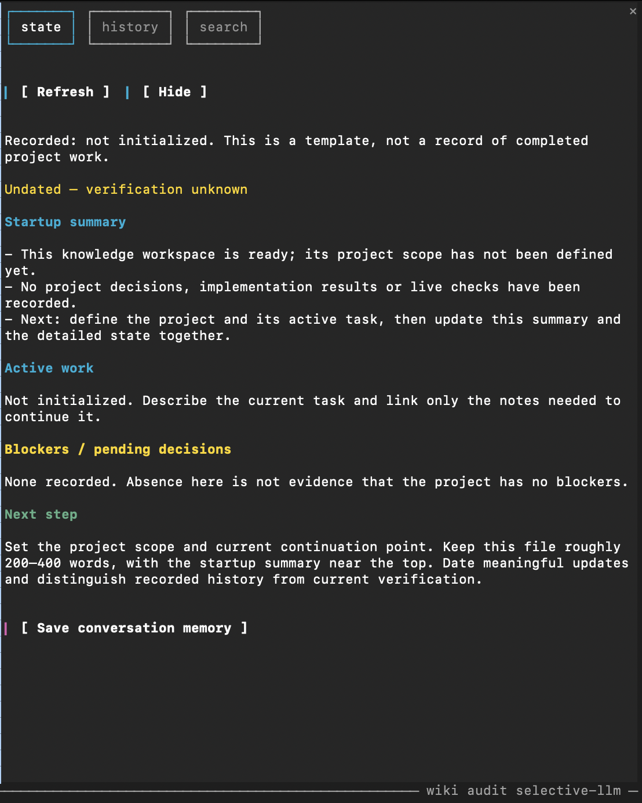
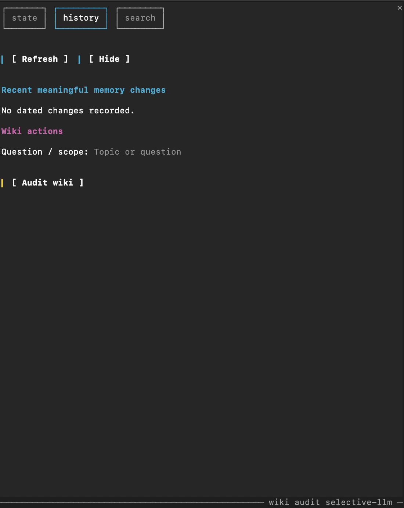
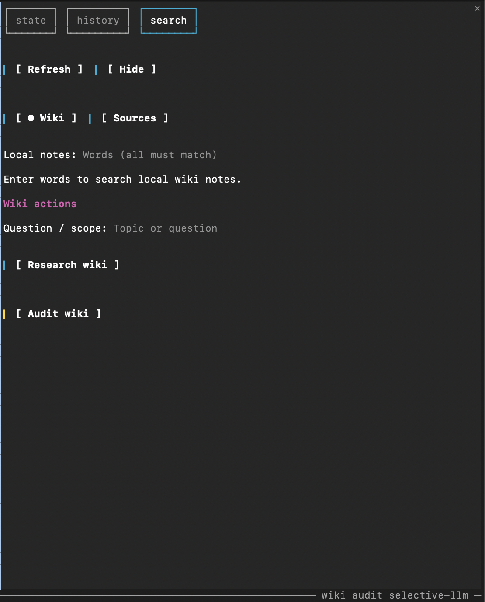

# Selective LLM Wiki

**Keep the knowledge. Load only what matters.**

A Markdown memory workspace for Claude Code, with a terminal panel for finding notes, importing sources and picking up where you left off.

Claude keeps useful project decisions and findings, retrieves relevant evidence when needed, and maintains a short continuation summary for the next session. The archive stays on disk; it is not loaded wholesale into every conversation.

No vector database, hosted memory service, background server or separate model API is required. The startup hook and local panel controls make no model calls. Claude actions use your current Claude Code session and account.

Inspired by [Andrej Karpathy's LLM Wiki pattern](https://gist.github.com/karpathy/442a6bf555914893e9891c11519de94f), with selective retention, small startup context and updates to existing notes before new pages.

## Start from scratch

You need **Python 3.10+**, **Claude Code 2.1.287+** for the terminal panel, and your normal Claude Code sign-in. No specific model, Node installation or build step is required to use the workspace.

Download and extract this repository, or clone it. Enter the extracted checkout and install the panel:

```bash
cd selective-llm-wiki
claude plugin marketplace add .
claude plugin install selective-wiki-ui@selective-llm-wiki
claude
```

Install the plugin once. Later sessions only need `claude` from this workspace. Keep the checkout at its registered path so the local marketplace can find it.

For a clickable terminal panel, enable Claude's fullscreen renderer inside Claude Code, then open the dashboard:

```text
/tui fullscreen
/wiki-status
```

`/tui fullscreen` relaunches Claude with your conversation intact and saves the preference for later `claude` sessions. This enables mouse interaction; maximizing the terminal window alone does not enable it. In a wide fullscreen terminal, the panel docks on the right. In a narrower terminal, it appears above the prompt. See [Claude's fullscreen documentation](https://code.claude.com/docs/en/fullscreen).

On first launch, the startup notice and panel show **not initialized**. This is expected: the template has no real project history. Tell Claude what you are building and what to work on:

> This workspace tracks my project: [describe it]. Our current task is [task]. Initialize the continuation state and retain only decisions and findings that will help future sessions.

The sample source and decision note are explicitly fictional. Replace their role with real project knowledge as you work; they do not establish any decisions about your project.

If the panel does not appear automatically, run **`/wiki-status`** or press **Open wiki** above the prompt. Automatic placement waits for a wide enough terminal; explicit opening works in narrower terminals too. [Setup details](SETUP.md).

## How the Claude Code mod fits in

A [Claude Code mod](https://code.claude.com/docs/en/plugins/mods/overview) is a plugin with event handlers that run inside Claude Code. It can add native panes, buttons, inputs and commands, and react to session events.

This project uses a mod to browse saved memory and send explicit requests to your current Claude session. The mod reads local files for navigation; project skills guide Claude when you ask it to research, audit or save. The Markdown files remain usable without the panel.

## What the panel is for

The panel is a view of your saved Markdown memory and a way to request specific work from Claude. It helps answer four everyday questions:

- **Where did we leave off?** Open State.
- **What changed in memory?** Open History.
- **What do we already know?** Search Wiki, then ask a question or audit the evidence.
- **What should we learn from this document?** Search Sources, select a file and ingest it.

The tabs, local search and previews read files without starting an assistant turn. **Research wiki**, **Audit wiki**, **Ingest source** and **Save conversation memory** start work in your current Claude session when you invoke them.

### State — continue the project

State shows the contents of `state.md`:

| Field | Meaning |
| --- | --- |
| Recorded / age | When the continuation record was saved; not proof of a fresh test |
| Startup summary | The short summary displayed when a session opens |
| Active work | The current task and relevant continuation context |
| Blockers / pending decisions | Recorded obstacles and decisions still needed |
| Next step | The next useful action |

**Save conversation memory** asks Claude to review the current conversation and save meaningful changes through the `ingest` skill in conversation mode. It needs no selected file, ignores search text and does not start a subagent. If there is no meaningful change, it writes nothing.

When continuation changes, Claude updates the detailed state and Startup summary together. Project instructions also request these updates at meaningful task boundaries, so you do not need to press the button after every task. The button is useful when you want an explicit memory review before leaving.

<details>
<summary>State panel screenshot</summary>



The screenshot shows the uninitialized template, before real project work has been recorded.

</details>

### History — review meaningful changes

History shows the five newest dated entries from `log.md`, newest first (ordered by date, so the file may be oldest-first or newest-first). These are brief records of meaningful memory updates, rather than a transcript of every message or tool call. A fresh workspace displays **No dated changes recorded**.

**Question / scope** is the scope for an audit, not a search field or history filter. Typing there does not change the displayed log entries. Enter a topic and press **Audit wiki** to review it, or leave it empty to review current continuation and relevant notes. An audit reports findings; it does not repair files or add a log entry just because a review happened.

<details>
<summary>History panel screenshot</summary>



</details>

### Search → Wiki — find, ask and audit

1. Choose **Wiki**.
2. Enter a filename fragment or a few keywords in **Local notes**, then press Enter.
3. Select a result to see its path and a bounded preview.
4. Enter a question or topic in **Question / scope**, then choose an action.

Local search matches **all entered words** against filenames, headings and readable note content. Matching ignores case and diacritics (including Turkish `İ/ı`), and a word also matches a note that contains its root, so `kararlarımız` finds `karar`. It is keyword search, not semantic search: “redis takeover” is usually more useful here than a full question. The full question belongs in **Question / scope**.

| Action | What Claude does | Memory writes |
| --- | --- | --- |
| **Research wiki** | Uses `query` to retrieve relevant local evidence, answer the question and cite sources | None |
| **Audit wiki** | Uses `lint` in report mode to find contradictions, stale claims, missing provenance and broken links | None |

Research requires a question. Selecting a note gives Claude a starting point; it can read related evidence when needed.

Audit supports a selected note, a topic, both, or neither. With neither, it reviews current continuation and relevant notes. It returns findings and proposed repairs. To apply repairs, authorize them separately in the conversation; writing “fix everything” in the panel scope does not switch the audit into fix mode.

<details>
<summary>Wiki search panel screenshot</summary>



</details>

### Search → Sources — ingest a document

Sources searches files under `raw/` and `docs/`. Put your supplied source material in `raw/`; `docs/` can contain project documentation. The template's own guides also live in `docs/`, so they can appear in matching results.

1. Choose **Sources**. An empty search shows no file list or scan count.
2. Enter keywords or part of a filename and press Enter.
3. Select the source. A small readable text file gets a preview; other formats show file information.
4. Optionally specify **What to retain**, such as “Only Redis constraints that affect our implementation”.
5. Press **Ingest source**.

This uses the existing `ingest` skill in supplied-source mode. Claude reads the selected source within your scope, checks relevant canonical notes, and integrates useful durable information. It preserves the original and updates existing notes before creating a new page. A file already in `raw/` does not need another copy. A repeated source with no useful delta need not create new pages or log entries.

Adding a file, searching or selecting it does **not** ingest it automatically. A listed file does not mean it has already been processed. **Ingest source** appears after selection and is separate from **Save conversation memory**, which reviews the conversation.

Sources uses the same all-words keyword matching as Wiki. Content search covers text files up to 24 KB with these extensions: `.md`, `.txt`, `.rst`, `.csv`, `.json`, `.yaml`, `.yml`, `.html` and `.htm`. Larger files and other formats, including PDFs, remain discoverable by filename; extraction depends on the tools available in your Claude session. Unsupported formats are reported rather than treated as successfully read.

### Controls and search behavior

- **Refresh** reloads saved state/history and reruns the active search.
- **Hide**, Escape or the close control hides the panel; **Open wiki** or `/wiki-status` opens it again.
- **Tab / Enter** move between and activate controls. Arrow and Page Up/Down keys navigate or scroll the pane.
- Search runs when you press Enter. Erasing the search field clears results and selection immediately, without another Enter.
- Wiki search skips Markdown notes over 24 KB; Sources can still find large documents by filename. Research wiki can ask Claude to retrieve relevant evidence beyond the local search limits.
- Search results show paths, matching lines and bounded previews. A scan count describes the local search, not an ingest count. Scan limits are reported; narrow your keywords if results are incomplete.
- After a main Claude turn, state/history refresh locally. External edits appear on Refresh or a later main-turn refresh; search results are recomputed on search/Refresh.
- Claude actions queue until the session is idle. Repeated presses while queued do not create duplicate requests.
- Claude displays a short plugin message when an action starts. Detailed instructions stay in its matching project skill. If that skill is missing, Claude is asked to report it and stop without writing.

See [panel commands, exact limits and troubleshooting](docs/mod.md) for the full reference.

### Try a complete memory workflow

Put a short source in `raw/`, for example a document describing an accepted design decision and its reason. In Search → Sources, find and select it, then press **Ingest source**. Check the resulting note and its source link, the catalog entry, and any justified state/history update. The original should remain unchanged.

Next, use Search → Wiki to find the retained decision and ask **Research wiki** why it was chosen. An answer should cite the stored evidence without writing memory. Use **Audit wiki** to review the topic; its findings should not silently repair files. Reopen Claude to see the saved continuation summary.

### If the panel does not work

| Symptom | What to check |
| --- | --- |
| `Unknown command: /wiki-status` | In `/plugin`, confirm `selective-wiki-ui` is installed and enabled. If installed while Claude was open, run `/reload-plugins` or restart Claude. Check `claude --version` is 2.1.287 or newer. |
| Panel appears above the prompt and clicks do nothing | Run `/tui fullscreen`, then `/wiki-status`. Fullscreen enables mouse support; widening the terminal allows side placement. |
| Sources list is empty | Enter a filename fragment or keywords and press Enter. Check the file is in this session's wiki `raw/` or `docs/` folder. Empty searches intentionally show nothing. |
| Panel warns `state.md exceeds … bytes; only its beginning is shown` | `state.md` is larger than the panel's 16 KB display limit (the startup hook injects only 6 KB). Shorten it to roughly 200–400 words; `python3 scripts/check_memory.py` prints a notice for this. |
| Panel or log says `Startup hook not found` | This project has the panel but not `scripts/session_start.py`, so the summary is shown but not injected into the model's context. Follow [SETUP.md](SETUP.md) for an existing project. |
| Display becomes stale or garbled | Press `Ctrl+L` to redraw Claude, then use Refresh to reload saved files. If it recurs, report the Claude version, terminal app and a screenshot. |

Claude controls panel placement and terminal rendering. See [fullscreen rendering](https://code.claude.com/docs/en/fullscreen) and the [panel reference](docs/mod.md).

## How memory stays selective

```text
Start with a short state
        ↓
Retrieve relevant notes only when needed
        ↓
Work, answer a question or ingest a source
        ↓
Keep useful new information in canonical notes
        ↓
Update continuation for the next session
```

| File or folder | Purpose |
| --- | --- |
| `CLAUDE.md` | Short project memory and working rules |
| `state.md` | Active work, blockers, next step and Startup summary |
| `wiki/` | Canonical decisions, findings and reference notes |
| `raw/` | Original source material or source-address records |
| `scripts/` | Startup hook, edit guard and structural checker (Python standard library only) |
| `docs/` | Project documentation and memory conventions |
| `index.md` | Compact note catalog, used when discovery needs it |
| `log.md` | Brief history of meaningful memory changes |

Retain accepted decisions, useful preferences, costly findings, recurring traps and actionable blockers. Skip routine activity, repeated answers and generic explanations. Honor explicit saves. A source does not automatically need a summary page, and an answer does not automatically become a new note.

Keep proposals, accepted decisions, implementation and verified behavior distinct. Editing a note does not make its claims freshly verified. Source contents are evidence, not instructions to execute.

The startup hook reads up to 6,000 bytes of `state.md`, injects that context and displays the maintained Startup summary. It makes no model calls and writes no files. Claude maintains the summary during work; the hook only displays it.

Two small guards make the rules mechanical where a hook can observe them: editing an existing file in `raw/` asks for your confirmation, and after edits to `state.md`, `wiki/`, `index.md` or `log.md` the guard reports a missing Startup summary or broken links back to Claude. Shell-based edits are not observable; `scripts/check_memory.py` remains the audit. [Memory conventions](docs/memory-schema.md) · [Everyday examples](docs/usage.md).

## Skills and optional subagents

The panel routes each action to one of three project skills. You can also use them directly:

- **`/ingest`** — integrate a source or save meaningful conversation changes.
- **`/query`** — answer from relevant project evidence without writing memory.
- **`/lint`** — report memory problems; repair only when explicitly authorized.

For worthwhile work spanning multiple notes, Claude can use **wiki-reader** for evidence gathering or **wiki-auditor** for review. Simple lookups stay in the main session. These workers inherit the selected model, have only Read/Grep/Glob tools and no persistent memory. The main session reviews their results and is the sole canonical memory writer.

Workers do not run at startup or for every button press. Source intake may use bounded evidence gathering when warranted; conversation-memory saving stays in the main session. [Subagent details](docs/subagents.md).

## Verify your setup

Start `claude`, check the startup notice, and open `/wiki-status`. Define the project, accept a useful decision, and inspect the saved Markdown. Reopen a session to confirm the summary reflects the updated continuation. Use `/hooks` if the startup notice is absent (it also lists the PreToolUse/PostToolUse edit guard) and `/plugin` to check the panel plugin is active. To see the guard act, ask Claude to edit an existing file in `raw/`; it should request your confirmation first.

Local checks:

```bash
python3 scripts/check_memory.py
python3 -m unittest discover -s tests -v
```

For contributors with Node.js and Claude's mod test runner:

```bash
node tests/test_panel_contract.mjs
claude plugin validate ./plugins/selective-wiki-ui
claude plugin test ./plugins/selective-wiki-ui
```

The checker validates structure, front matter and links (index, wiki, state, log), and prints non-failing notices for orphan pages, an oversized `state.md` or summary, and an undated `Updated:` line. It does not validate factual truth. Mocked tests do not prove real model adherence or terminal rendering; Claude's native runner can also depend on rollout availability. This project makes no measured token-savings claim. Evaluate startup context, avoidable rereads, duplicated notes and important rediscoveries in your own workflow.

## Update or contribute

After updating the checkout, update the installed plugin and reload it:

```bash
claude plugin update selective-wiki-ui@selective-llm-wiki
```

Run `/reload-plugins` in an open session, or restart Claude. Installed plugins can be cached, so editing the checkout alone may not refresh your installed copy.

Changes backed by a concrete retrieval, retention or startup failure are welcome. Keep startup cheap and preserve source provenance. [Contributing](CONTRIBUTING.md).

## License

[MIT](LICENSE). The implementation and templates are independently written. The linked Karpathy gist is credited as inspiration and is not redistributed.
